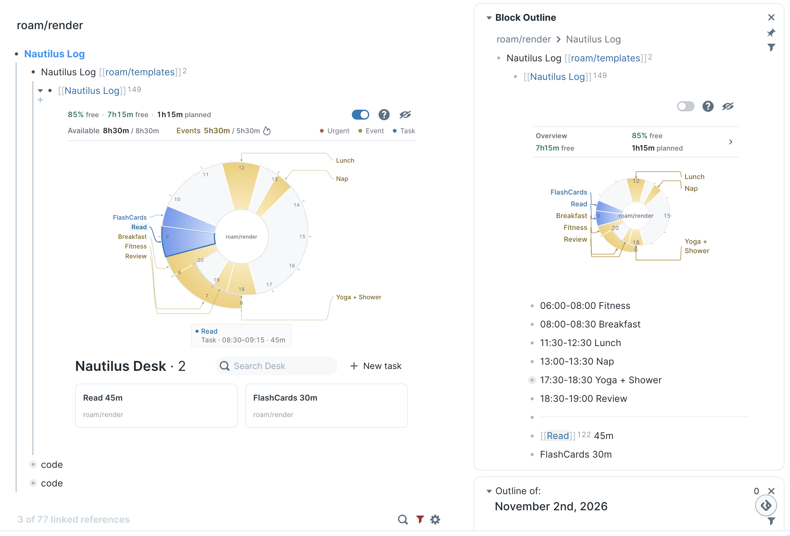

# Nautilus Log

> **Give every minute a job.**

A visual day planner for Roam Research. Fixed events keep their time, whole tasks
fill the remaining gaps in your chosen order, and work that cannot fit stays visible.
Your Daily Note and its native blocks remain the source of truth.

**English** · [简体中文](./README.zh-CN.md) · [User guide](./docs/guide.md)



## Quick start

1. Install **Nautilus Log** from Roam Depot. For a draft update, use the ShortHand
   in its Depot pull request.
2. Click **+ Create today's plan**. One click copies your managed template into
   today's Daily Note and opens it. Existing plans are opened without duplication.
3. Add events and tasks as direct children, then order the tasks and estimate them.

```text
05:00-06:00 Morning routine
{{[[TODO]]}} Write project brief 45m
{{[[TODO]]}} Review notes 30m
11:45-12:30 Lunch
```

Durations support `30m`, `30min`, `1h`, and `1h30m`. Ordinary top-level notes also
count as tasks; a missing estimate uses **Default Todo Duration** (15 minutes by
default). Child notes and logs stay with their parent and do not add scheduling demand.

The always-available command **Nautilus Log: Create or open today’s Daily Note plan**
explicitly targets the calendar date. During an active overnight window, the topbar
launcher instead opens that existing workday's plan. See [overnight workdays](./docs/guide.md#active-overnight-workdays).

## Read and adjust the plan

- **Keep your order.** Scheduling never splits a task or lets a later task jump
  ahead. **Today won't fit** keeps the remaining queue visible.
- **Keep commitments explicit.** Marking an event DONE does not cancel its written
  time range. Edit or remove the range to release it. Flexible tasks fill free gaps
  in their own order; fixed-event rows do not impose an extra ordering restriction.
- **Read the budget.** `free` means unassigned time divided by the full workday's
  flexible capacity. Planned demand is already deducted. It measures a time budget,
  not physical energy or the percentage of the day still on the clock.
- **Read the evidence.** Actual sums recorded CLOCK sessions. The spiral displays
  that total as one interval ending at completion; it does not replay each session.
  Estimated completed records carry a small `≈` cue. Tips explain duration and placement.
- **Work in Desk.** Its native-style cards edit the original blocks. **New task**
  inserts an implicit task at the front of the plan without adding a TODO marker.
  Dragging changes task order; nested logs stay attached. Removal and outside-block
  drops follow the [native ownership rules](./docs/guide.md#safe-outside-block-references). New outside-block drops use a native embed; older references stay unchanged.

The controls are **Help → Chart/List**, with optional Calendar between them. The switch
selects the spiral plus Desk cards or the original editable block list. Roam's native caret
folds the whole region and restores the selected view when expanded. Completed records
remain visible in the chart. **Current task / Current event** identifies the
current chart interval, not a running CLOCK. These labels use the time-pointer red,
while titles retain their category colors. Task order changes only through your outline
edits or explicit Desk moves.

## Choose how much to enable

**Planning is the default.** The spiral, Desk, and lightweight create/open launcher
work with the Execution Layer off. This avoids its execution popover, one-second
ticker, and CLOCK writer. A chart can still read existing CLOCK history.

**Execution Layer · Advanced** adds **Timing**, **Plan**, and **Review**, plus the
panel's standalone **POMO** action. CLOCK takes priority over POMO; switching tasks
closes the previous CLOCK before starting the next. Standalone POMO records no CLOCK
or Actual, but uses the same execution entry, so the separate Roam Logbook extension
must be disabled before enabling it. The optional capacity gauge keeps the compact
`% free · planned duration` summary.

**Completion timestamp** is independent and default off. Confirmed native completion
can append one `dHH:MM` without starting CLOCK/POMO or measuring Actual. Only a suffix
still verifiably owned by Nautilus can be removed on reopening. Disable Todo Trigger
on every client before enabling this option. See [completion timestamps](./docs/guide.md#optional-completion-timestamps).

An existing overnight plan remains the active owner until its END. Capacity, task
actions, CLOCK totals, and Review use that owner date. Calendar-day creation stays
explicit, and reaching END does not stop a running CLOCK.

## Optional Google Calendar sync

Connect your account in Nautilus settings using Google's read-only authorization.
The chart's Calendar button manually imports timed busy events and dated Google
Tasks for the clicked plan. It does not poll Google or create Daily Notes.

Normal sync preserves local edits; Option/Alt-click restores Google-managed fields
while preserving user-created children. Imported Google Tasks inherit the default
task duration unless you add an estimate. Users do not configure OAuth clients or
paste secrets. See [Calendar setup and recovery](./docs/google-calendar-sync.md)
and the [privacy contract](./PRIVACY.md).

## Upgrades and recovery

The current renderer uses source revision 3 with its own namespace and runtime bridge.
Its permanent source UID retains the historical `r2` spelling. An upgrade changes
only the managed template's renderer reference and the active Primary Plan reference;
prefixes, arguments, child content, and presentation properties are preserved.
Historical plans remain readable through the compatibility reader. Ambiguous targets
or unexpected source content produce a notice and are left intact.

Update every client. Older packages can still change their legacy source blocks or
template, and no local extension can coordinate all other devices. Migration does
not scan history or blindly retry an uncertain write. Plan creation likewise keeps
verified recovery receipts: a reload can inspect or verify an incomplete copy, but
cannot resume it from a different template. Details are in the
[user guide](./docs/guide.md#renderer-upgrades).

## Local verification

```sh
npm test
PYTHONDONTWRITEBYTECODE=1 npm run test:ui
```

Browser checks require an existing Python Playwright installation and Chromium.
The suites use isolated graph fixtures, including complete old/current CLJS sources,
real renderer services, template recovery, and overnight runtime/UI cases. Reported
skips remain unverified. These checks do not certify live Roam Desktop, operating-system
IME, atomic native Undo, Calendar authorization, or cross-device behavior.

## Credits

- [Nautilus](https://github.com/tombarys/roam-depot-nautilus) by Tomáš Baránek:
  the original spiral-planning concept.
- [Nautilus Enhanced](https://github.com/hopeserena/nautilus-enhanced): the fork
  from which this project developed.
- [Roam Logbook](https://github.com/forrestchang/roam-logbook): the inspiration
  for compatible CLOCK tracking and focused execution.

The time-allocation philosophy is inspired by the
[YNAB Method](https://www.ynab.com/the-four-rules/). Nautilus Log is not affiliated
with YNAB. Released under the original MIT license.
