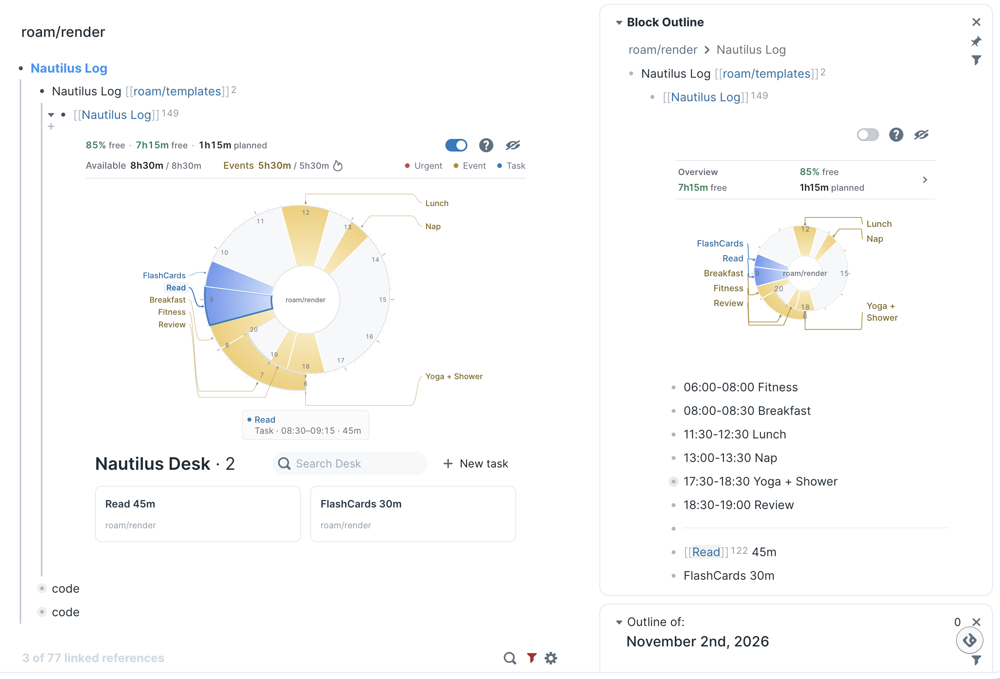

# Nautilus Log

> **给每一分钟分配一份工作。**

面向 Roam Research 的可视化日计划工具。固定事件保留时段，完整任务按你决定的顺序
进入空档，放不下的工作始终可见。Daily Note 和原生 block 是数据依据。

[English](./README.md) · **简体中文** · [使用指南](./docs/guide.zh-CN.md)



## 快速开始

1. 从 Roam Depot 安装 **Nautilus Log**；试用 Draft 更新时，使用对应 Depot PR 的 ShortHand。
2. 点击 **＋ 创建今日计划**，一次点击即可把受管理模板复制到今天的 Daily Note 并打开。
   已有计划时直接打开，不重复创建。
3. 把事件和任务写成组件的直接子级，排列任务并填写估时。

```text
05:00-06:00 Morning routine
{{[[TODO]]}} 撰写项目简报 45m
{{[[TODO]]}} 复习笔记 30m
11:45-12:30 Lunch
```

时长支持 `30m`、`30min`、`1h` 和 `1h30m`。顶层普通文字也会作为任务；没有估时的任务
使用**默认任务时长**，初始为 15 分钟。子级笔记和日志属于父任务，不单独增加排程需求。

始终可用的命令 **Nautilus Log: Create or open today’s Daily Note plan** 明确面向日历当天。
跨午夜工作时，顶栏入口会打开仍在活动窗口内的那一份计划。详见[活动跨夜工作日](./docs/guide.zh-CN.md#活动跨夜工作日)。

## 理解和调整计划

- **保留你的顺序。** 不自动拆分任务，也不让后面的任务抢先执行；剩余队列放在**今日放不下**。
- **明确保留预约。** 事件标记 DONE 后，写明的时段仍然占用预算；要提前释放，应修改或删除时段。
  弹性任务按自身顺序填入空档，固定事件在大纲中的位置不会再限制它们的最早开始时间。
- **理解预算。** “未分配”（英文 `free`）表示扣除 Planned 后的空余预算占全天弹性容量的比例。
  它衡量时间预算，不代表生理精力，也不是时钟还剩多少的百分比。
- **区分证据。** Actual 汇总 CLOCK 会话时长，图上把总量放到以完成时刻为终点的一段区间中，
  不逐段重放会话。采用估时的完成项带有小型 `≈` 标记，Tips 说明时长与摆放依据。
- **在 Desk 中工作。** 原生样式卡片编辑原 block；**新任务**在计划最前面插入隐式任务，不强加 TODO。
  拖拽改变任务顺序，嵌套日志随任务保留。移除和外部拖入遵循[原生归属规则](./docs/guide.zh-CN.md#安全的外部-block-引用)。

控件顺序为 **Desk → 帮助 → Eye off**，之后是可选 Calendar。帮助解释当前配置与预算；眼睛控制收起／展开，
完成记录在展开时始终可见。「当前任务／当前事件」标识当前图表时段，不表示 CLOCK 正在计时。状态文字使用时间指针红色，标题保留分类颜色；任务顺序只随明确的大纲编辑或 Desk 移动改变。

## 按需启用功能

**默认只做规划。** 执行层关闭时，海螺图、Desk 和轻量创建／打开入口仍可使用，不启动执行面板、
一秒刷新或 CLOCK 写入器。图表仍可读取已有 CLOCK 历史。

**执行层 · 进阶**增加 **Timing、Plan、Review**，并在面板内提供独立 **POMO**。CLOCK 优先于 POMO，
切换任务前先结束上一条 CLOCK。独立 POMO 不写 CLOCK，也不增加 Actual，但仍使用同一个执行入口，
因此启用前需关闭单独的 Roam Logbook 扩展。可选容量槽显示紧凑的“未分配比例 · 计划时长”。

**完成时间戳**独立、默认关闭。确认原生完成操作后，可追加一个 `dHH:MM`，不启动 CLOCK/POMO，
也不计量 Actual。重新打开时，仅删除仍能确认归属 Nautilus 的那个后缀。开启前应在所有客户端
停用 Todo Trigger。详见[可选完成时间戳](./docs/guide.zh-CN.md#可选完成时间戳)。

已有跨夜计划会一直作为活动工作日，直到它的 END；容量、任务操作、CLOCK 合计和 Review 共用其归属日期。
日历当天的新建仍需明确操作，到达 END 也不会自动停止正在运行的 CLOCK。

## 可选 Google Calendar 同步

在设置中用 Google 的只读授权连接账号。图表上的 Calendar 按钮按所点击计划的日期手动导入
定时忙碌事件和有日期的 Google Tasks，不后台轮询，也不创建 Daily Note。

普通同步保留本地改动；Option/Alt + 点击恢复 Google 托管字段，仍保留用户创建的子级。
Google Tasks 没有估时时使用默认任务时长。用户无需配置 OAuth Client 或粘贴密钥。
详见[Calendar 设置与恢复](./docs/google-calendar-sync.md)及[隐私说明](./PRIVACY.md)。

## 升级与恢复

r2 使用独立的源码 UID、命名空间和运行桥。升级仅变更受管理模板与活动 Primary Plan 的 renderer 引用，
保留前缀、参数、子级内容和呈现属性。历史计划通过兼容读取器继续展示；目标含糊或源码不符时会提示，保留原内容。

请更新所有客户端。旧客户端仍可能修改自己的旧源码块或模板，本地扩展无法协调所有其他设备。
迁移不扫描历史，也不盲目重试未确认的写入。计划创建同样保留可验证的恢复记录：重载后可检查和验证
未完成副本，不能换一个模板继续补写。详见[渲染器升级](./docs/guide.zh-CN.md#渲染器升级)。

## 本地验证

```sh
npm test
PYTHONDONTWRITEBYTECODE=1 npm run test:ui
```

浏览器检查需要已有的 Python Playwright 和 Chromium。套件使用隔离图谱，覆盖完整的新旧 CLJS、
真实渲染服务、模板恢复、跨午夜运行逻辑与界面。报告中的跳过项不算已验证；这些检查不等于真实
Roam Desktop、操作系统输入法、原子原生 Undo、Calendar 授权或跨设备验证。

## 致谢

- Tomáš Baránek 的 [Nautilus](https://github.com/tombarys/roam-depot-nautilus)：原始螺旋日计划理念。
- [Nautilus Enhanced](https://github.com/hopeserena/nautilus-enhanced)：本项目继续开发所基于的分支。
- [Roam Logbook](https://github.com/forrestchang/roam-logbook)：兼容 CLOCK 计时与聚焦执行的灵感来源。

时间分配哲学受到 [YNAB Method](https://www.ynab.com/the-four-rules/) 启发；Nautilus Log 与 YNAB 没有关联。
项目沿用原始 MIT License。
